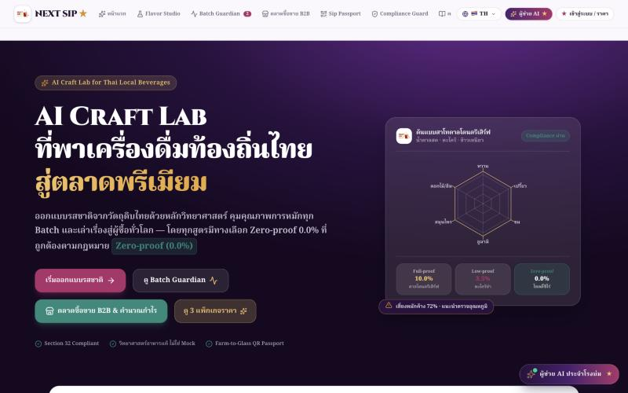
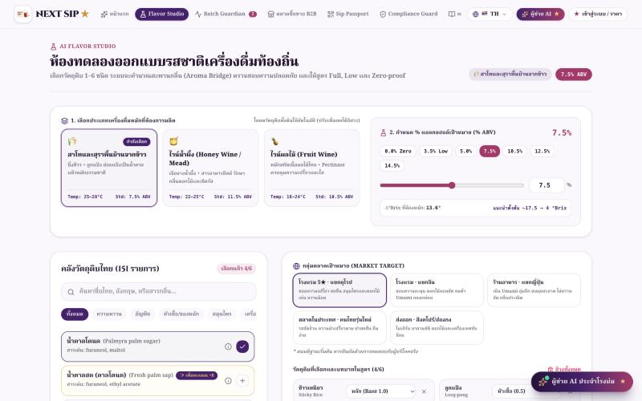
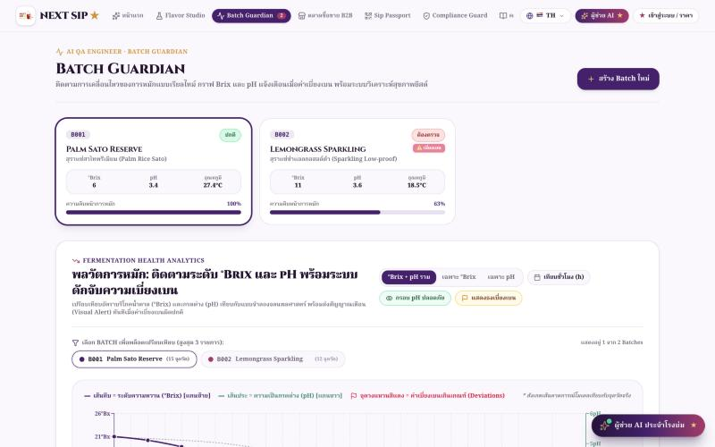
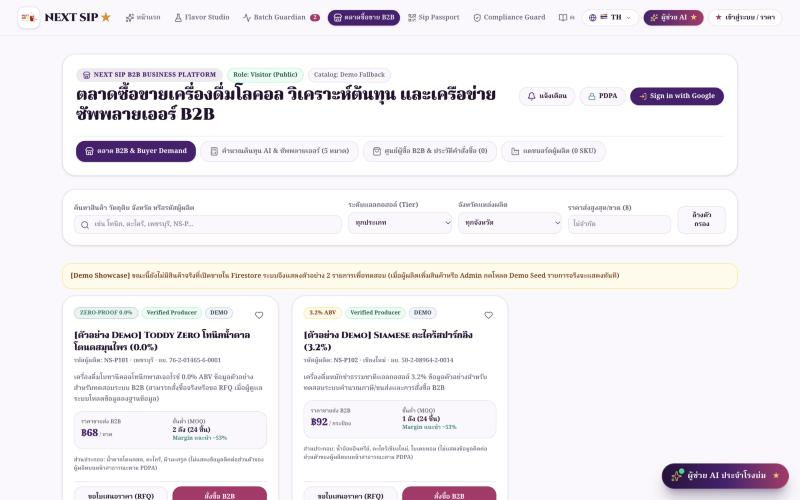
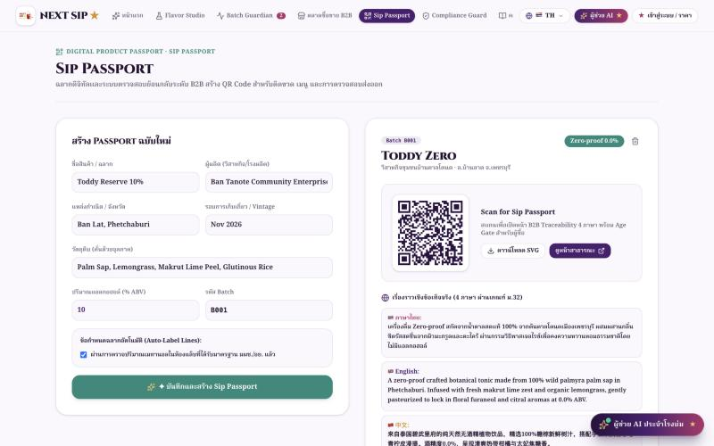
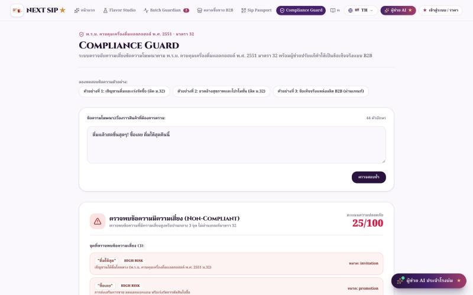
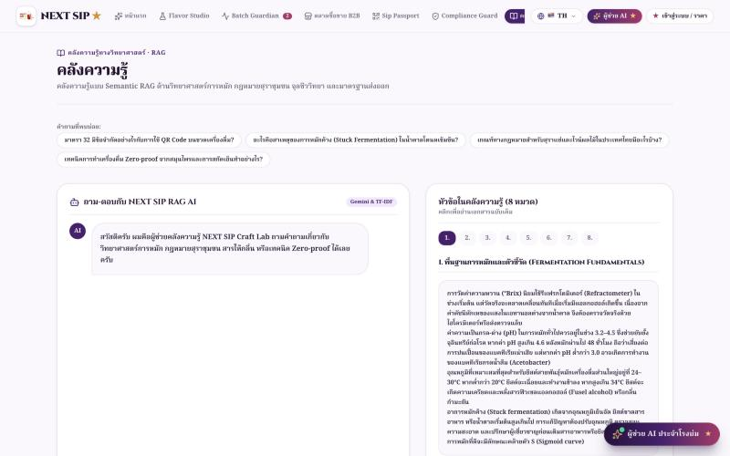
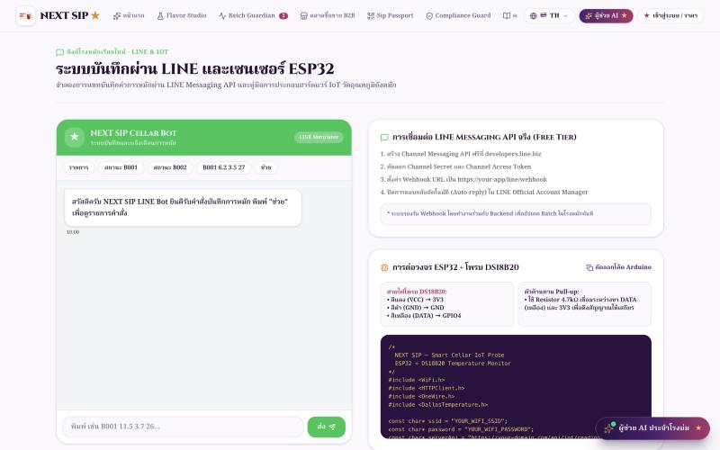
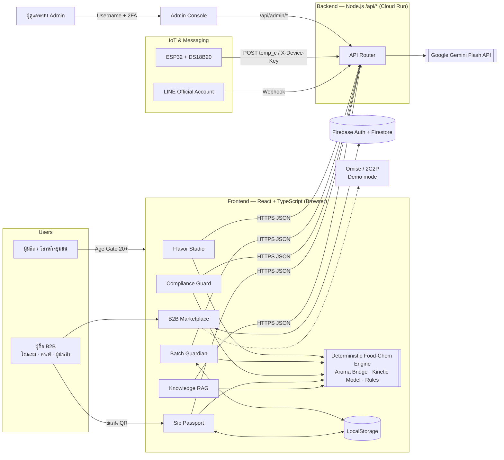
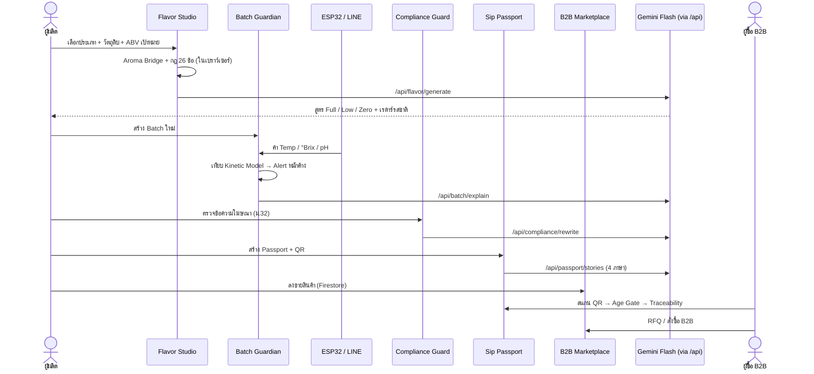

# NEXT SIP ★ — AI Craft Lab for Thai Local Beverages

> **Taste Thailand, Responsibly.**
> แพลตฟอร์ม AI ที่พาเครื่องดื่มท้องถิ่นไทย (สุราแช่ชุมชน สาโท ไวน์ผลไม้ เครื่องดื่มหมัก และ Zero-proof 0.0%) สู่ตลาดพรีเมียมและตลาดส่งออก

| | |
|---|---|
| 🌐 **Live Demo** | **https://next-sip.ai.studio** |
| 🏆 **Event** | Thailand AI Extreme Hack 2026 — Business Engineering Edition (UTCC) · Track **SPIRITS HACK!** |
| 👥 **Team** | NEXT SIP ★ — เวย์ · ขนมผิง · กร |
| 🧪 **Status** | Working prototype (MVP) — ดูส่วน [Current Limitations](#8-current-limitations--mock--simulation) |



---

## สารบัญ

1. [Project Overview](#1-project-overview)
2. [Problem & Solution](#2-problem--solution)
3. [MVP / Features ที่ทำงานได้จริง](#3-mvp--features-ที่ทำงานได้จริง)
4. [Tech Stack](#4-tech-stack)
5. [Architecture / System Flow](#5-architecture--system-flow)
6. [Setup / Run Instructions](#6-setup--run-instructions)
7. [Screenshots / Demo / Deployment](#7-screenshots--demo--deployment)
8. [Current Limitations / Mock / Simulation](#8-current-limitations--mock--simulation)
9. [Scientific References](#9-scientific-references)

---

## 1. Project Overview

**NEXT SIP** คือ "AI Craft Lab" — ระบบปฏิบัติการครบวงจรสำหรับผู้ผลิตเครื่องดื่มคราฟต์ไทย ครอบคลุมตั้งแต่ **ออกแบบรสชาติ → ควบคุมการหมัก → ตรวจคำโฆษณาตามกฎหมาย → ทำฉลากดิจิทัลส่งออก → ขายแบบ B2B** ในแพลตฟอร์มเดียว

ทุกสูตรที่ระบบออกแบบมี 3 ระดับ (3 Tiers) เสมอ:

| Tier | ABV | ตัวอย่าง |
|---|---|---|
| Full-proof | ~7.5–14.5% | ตาลโตนดรีเสิร์ฟ 10.0% |
| Low-proof | ≤ 3.5% | ตะไคร้ซ่า 3.5% |
| **Zero-proof** | **0.0%** | โทดดี้ซีโร่ (Toddy Zero) 0.0% |

กลุ่มผู้ใช้หลัก: วิสาหกิจชุมชน/ผู้ผลิตสุราแช่, คราฟต์แบรนด์, ผู้ซื้อ B2B (โรงแรม 5 ดาว คาเฟ่ ร้านอาหาร ผู้นำเข้า)

---

## 2. Problem & Solution

### Problem

| # | ปัญหา | ข้อมูลประกอบ |
|---|---|---|
| 1 | กฎหมายปลดล็อกสุราชุมชนแล้ว แต่ผู้ผลิตรายย่อยขาดความรู้ด้านวิทยาศาสตร์อาหาร ออกแบบสูตรแบบลองผิดลองถูก | กฎหมายปลดล็อกสุราชุมชนมีผล 6 มิ.ย. 2568 |
| 2 | ตลาดถูกครองโดยแบรนด์ใหญ่ ผู้ผลิตท้องถิ่นแข่งด้วยราคาไม่ได้ ต้องไปตลาดพรีเมียม | 3 แบรนด์ใหญ่ครองตลาดเบียร์ ≈ 90% |
| 3 | การหมักแบบดั้งเดิมไม่มีการวัดค่า → หมักค้าง, เปรี้ยวเสีย, คุณภาพไม่สม่ำเสมอทุก Batch | — |
| 4 | การโฆษณาเครื่องดื่มแอลกอฮอล์ติดข้อจำกัด **พ.ร.บ. ควบคุมเครื่องดื่มแอลกอฮอล์ พ.ศ. 2551 มาตรา 32** — เล่าเรื่องสินค้าผิดนิดเดียวมีโทษ | — |
| 5 | ผู้ซื้อต่างประเทศ/โรงแรมต้องการข้อมูลตรวจสอบย้อนกลับและเรื่องราวหลายภาษา | — |
| 6 | เทรนด์โลกไปทาง No/Low alcohol แต่ผู้ผลิตไทยยังไม่มีสูตร Zero-proof | ตลาดเครื่องดื่มไร้แอลกอฮอล์โลกโต +7%/ปี (IWSR 2025) |

### Solution

NEXT SIP ใช้ AI 4 บทบาท + เครื่องมือธุรกิจ ทำงานร่วมกัน:

| บทบาท AI | โมดูล | แก้ปัญหา |
|---|---|---|
| **AI R&D Scientist** | Flavor Studio | ออกแบบสูตรจากวัตถุดิบไทย 151 ชนิด ด้วยสารให้กลิ่นจริง + กฎวิทยาศาสตร์อาหาร 26 ข้อ (#1, #6) |
| **AI QA Engineer** | Batch Guardian + LINE/ESP32 | ติดตาม °Brix / pH / อุณหภูมิ เทียบโมเดลจลนพลศาสตร์ แจ้งเตือนหมักค้างล่วงหน้า (#3) |
| **AI Compliance Officer** | Compliance Guard | ตรวจคำโฆษณาตาม ม.32 และให้ Gemini เรียบเรียงใหม่เป็นข้อเท็จจริง (#4) |
| **Multilingual B2B Storyteller** | Sip Passport | ฉลากดิจิทัล QR + เรื่องราว 4 ภาษา (TH/EN/中文/日本語) (#5) |
| **Business Platform** | ตลาด B2B & คำนวณต้นทุน | Marketplace, RFQ, Buyer Demand Matching, วิเคราะห์ต้นทุน/Margin (#2) |
| **Knowledge Assistant** | คลังความรู้ (RAG) | ถาม-ตอบวิทยาศาสตร์การหมัก กฎหมาย มาตรฐานส่งออก (#1) |

---

## 3. MVP / Features ที่ทำงานได้จริง

> ทุกฟีเจอร์ด้านล่างใช้งานได้จริงบน https://next-sip.ai.studio

### 3.1 Flavor Studio — AI R&D Scientist

- เลือกประเภทเครื่องดื่มหมัก: **สาโท/สุราพื้นบ้านจากข้าว** (25–28°C, 7.5%), **ไวน์น้ำผึ้ง/Mead** (22–25°C, 11.5%), **ไวน์ผลไม้** (18–24°C, 10.5%) → โหลดวัตถุดิบตั้งต้นอัตโนมัติ
- ตั้ง % ABV เป้าหมาย (0.0–14.5%) → คำนวณ Δ°Brix ที่ต้องหมัก และค่า °Brix ตั้งต้นที่แนะนำ
- คลังวัตถุดิบไทย **151 รายการ** 14 หมวด พร้อม **สารให้กลิ่นเด่น** (เช่น furaneol, citral, linalool, 2-acetyl-1-pyrroline) และป้ายเตือน Heat-loss / Caution / Color
- จับคู่ **Aroma Bridge** (สะพานสารกลิ่น), เลือกกลุ่มตลาดเป้าหมาย (โรงแรม 5★, ร้านญี่ปุ่น, ส่งออกสิงคโปร์/ฮ่องกง ฯลฯ)
- ได้สูตร 3 Tiers, เรดาร์รสชาติ 6 แกน (หวาน/เปรี้ยว/ขม/อูมามิ/สมุนไพร/ดอกไม้-ส้ม) และสูตรทดลอง 1 ลิตร
- Gemini ช่วยสร้างคำอธิบายสูตร (`/api/flavor/generate`)

### 3.2 Batch Guardian — AI QA Engineer

- สร้าง/ติดตามหลาย Batch พร้อมกัน (ตัวอย่าง B001 Palm Sato Reserve, B002 Lemongrass Sparkling)
- กราฟ **°Brix + pH** เทียบ **Fermentation Kinetic Model** (เส้นโค้ง Sigmoid) เปรียบเทียบได้สูงสุด 3 Batch
- **Visual Alert**: °Brix เบี่ยงจากโมเดล ≥ 1.5 → เหลือง, ≥ 2.0 หรือหยุดลดใน 24 ชม. → ธงแดง "หมักค้าง"; pH ไม่ลงต่ำกว่า 4.5 ใน 36–48 ชม. หรือต่ำกว่า 3.1 → วงแหวนส้ม
- คำนวณ ETA, ความเสี่ยง (0–100), **ABV คาดการณ์**
- **Yield Estimator**: คำนวณปริมาตรสุทธิหลังหักกาก/ตะกอน/การระเหย และจำนวนขวด (330/500/750 mL)
- บันทึกค่าวัดด้วยตนเอง + ปุ่ม **"Gemini อธิบาย"** วิเคราะห์สาเหตุ (`/api/batch/explain`)

### 3.3 ตลาดซื้อขาย B2B & คำนวณต้นทุน

- Catalog สินค้า กรองตาม Tier (Zero/Low/Full), จังหวัด, ราคาส่งสูงสุด
- ขอใบเสนอราคา (**RFQ**), สั่งซื้อ B2B, MOQ, Margin แนะนำ
- **Buyer Demand Matching** — โรงแรม/คาเฟ่ประกาศสเปคที่ต้องการ ให้ผู้ผลิตที่ผ่าน KYC เสนอขาย
- **AI Cost Calculator** + เครือข่ายซัพพลายเออร์ 5 หมวด (`/api/cost/analyze`)
- ศูนย์ผู้ซื้อ (ประวัติคำสั่งซื้อ) และแดชบอร์ดผู้ผลิต (SKU)
- **Firebase Auth (Google Sign-In)** + RBAC 4 ระดับ: Visitor / Buyer / Producer / Admin พร้อม KYC และ PDPA Privacy Center
- แพ็กเกจราคา 3 ระดับ: Community Starter ฿0, Artisan Pro ฿790/เดือน, Enterprise Export ฿2,390/เดือน (ชำระรายปี)

### 3.4 Sip Passport — Multilingual B2B Storyteller

- ฟอร์มสร้าง Digital Product Passport (ชื่อสินค้า, ผู้ผลิต, จังหวัด, Vintage, วัตถุดิบ, ABV, รหัส Batch)
- Auto-Label Lines (เช่น ผ่านการตรวจเมทานอลตาม มผช./อย.)
- สร้าง **QR Code** + ดาวน์โหลด **SVG (vector)** + หน้าสาธารณะ B2B Traceability พร้อม **Age Gate (20+)**
- Gemini เขียนเรื่องราวเชิงข้อเท็จจริง **4 ภาษา** ที่ผ่านเกณฑ์ ม.32 (`/api/passport/stories`)

### 3.5 Compliance Guard — มาตรา 32

- ตรวจข้อความโฆษณา/เรื่องราวสินค้า แยกหมวดความเสี่ยง: `invitation` (เชิญชวนดื่ม), `promotion` (ลดแลกแจกแถม/เร่งซื้อ), `superlative`, การอวดอ้างสุขภาพ ฯลฯ
- ให้ระดับความเสี่ยง HIGH/MEDIUM/LOW และ **คะแนนความปลอดภัย 0–100**
- ปุ่ม **"Gemini ช่วยปรับแก้"** เรียบเรียงใหม่เป็นข้อความข้อเท็จจริงแบบ B2B (`/api/compliance/rewrite`)

### 3.6 คลังความรู้ (Semantic RAG)

- คลังเอกสาร 8 หมวด: พื้นฐานการหมัก, กฎหมายสุราชุมชน, จุลชีววิทยา, มาตรฐานส่งออก, Zero-proof ฯลฯ
- ถาม-ตอบด้วย **TF-IDF retrieval + Gemini** (`/api/rag/query`) พร้อมคำถามที่พบบ่อย

### 3.7 LINE Bot & IoT (ESP32 + DS18B20)

- **LINE Simulator** — บันทึกค่าหมักผ่านแชท เช่น `B001 6.2 3.5 27` (Brix pH Temp), `สถานะ B001`, `ช่วย`
- คู่มือเชื่อม LINE Messaging API จริง (Webhook)
- คู่มือต่อวงจร + โค้ด Arduino สำหรับ **ESP32 + โพรบ DS18B20** ส่งอุณหภูมิทุก 60 วินาที → ดู [`hardware/esp32-ds18b20/`](hardware/esp32-ds18b20/)

### 3.8 Thailand Compliance Gate — ยืนยันอายุ 20+
- หน้าต่างคัดกรองอายุตาม พ.ร.บ. ควบคุมเครื่องดื่มแอลกอฮอล์ พ.ศ. 2551 แสดงก่อนเข้าใช้งานแพลตฟอร์ม
- ผู้ใช้เลือกปีเกิด (แสดงทั้ง ค.ศ./พ.ศ.) แล้วยืนยันอายุ 20 ปีบริบูรณ์ขึ้นไป หรือกด "อายุน้อยกว่า 20 ปี"
- มีทางเข้า **Admin Portal** จากหน้านี้

### 3.9 Admin Operations & Compliance Console
- ระบบหลังบ้านแยกจากบัญชีลูกค้า ล็อกอินด้วย Username/Password
- **Security & RBAC:** เข้ารหัสรหัสผ่านด้วย bcrypt, ป้องกัน Brute-Force (Lockout), CSRF & Session Guard, **TOTP 2FA**, HTTPS / HttpOnly Cookie Session, บังคับเปลี่ยนรหัสผ่านเมื่อเข้าครั้งแรก, ลืม/รีเซ็ตรหัสผ่าน
- **Thai Beverage Law:** คัดกรองอายุ 20+, ตรวจข้อความต้องห้าม ม.32, จำกัดคำสั่งซื้อแอลกอฮอล์เฉพาะผู้ผ่าน KYC
- โมดูลจัดการ: ภาพรวม, สินค้า, หมวดหมู่, แบรนด์, สต็อก (Inventory), คำสั่งซื้อ, ลูกค้า, เนื้อหา, Analytics, ผู้ใช้/สิทธิ์, ตั้งค่า และ **Audit Log** แบบเรียลไทม์

### 3.10 อื่น ๆ
- **ผู้ช่วย AI ประจำโรงบ่ม** (Floating chat, `/api/chat`)
- รองรับหลายภาษา (TH/EN)
- **Settings**: สถานะ Gemini (`/api/health`), Backup/Restore ข้อมูลเป็น JSON, รีเซ็ตข้อมูลตัวอย่าง, ล้าง RAG cache, รายการงานวิจัยอ้างอิง
- นโยบายความเป็นส่วนตัว (PDPA)

---

## 4. Tech Stack

| Layer | Technology |
|---|---|
| **Frontend** | React + TypeScript, Vite build, Tailwind-style utility CSS, Recharts / D3 (กราฟ), Lucide icons, Motion (animation), `qrcode` (สร้าง QR/SVG) |
| **Backend** | Node.js API server (endpoints `/api/*`) ทำหน้าที่ proxy เรียก Gemini เพื่อไม่เปิดเผย API key ฝั่ง client |
| **AI Model** | **Google Gemini Flash API** — สร้างสูตร, อธิบาย Batch, เขียนเรื่องราว 4 ภาษา, ปรับคำโฆษณา, RAG, Chat |
| **AI / Algorithm ฝั่ง client** | Deterministic Food-Chemistry Engine (Aroma Bridge, กฎ 26 ข้อ, Fermentation Kinetic Model, Yield Estimator, Compliance rule-based detector, TF-IDF retrieval) — คำนวณในเบราว์เซอร์ 100% |
| **Database** | **Firebase Firestore** (Marketplace, Orders, KYC, Buyer Demand) + **LocalStorage** (Batches, Passports ของผู้ใช้) |
| **Auth** | **Firebase Authentication** (Google Sign-In) + RBAC 4 ระดับ สำหรับผู้ใช้ · **Admin Auth แยก**: bcrypt, TOTP 2FA, HttpOnly Cookie Session, CSRF protection, Brute-force lockout, Audit Log |
| **Integration / API** | LINE Messaging API (Webhook), IoT REST endpoint สำหรับ ESP32, Payment Gateway Omise / 2C2P (Demo mode) |
| **Hardware** | ESP32 + DS18B20 waterproof temperature probe + Resistor 4.7kΩ |
| **Cloud / Deployment** | Google AI Studio → Google Cloud (Cloud Run) · โดเมน `next-sip.ai.studio` |

### API Endpoints

| Method | Endpoint | หน้าที่ |
|---|---|---|
| GET | `/api/health` | ตรวจสถานะ server และ Gemini (`{"status":"ok","geminiReady":true}`) |
| POST | `/api/flavor/generate` | สร้างสูตร/คำอธิบายรสชาติ |
| POST | `/api/batch/explain` | วิเคราะห์สถานะการหมักและสาเหตุความผิดปกติ |
| POST | `/api/process/analyze` | วิเคราะห์กระบวนการผลิต |
| POST | `/api/passport/stories` | เขียนเรื่องราวสินค้า 4 ภาษา |
| POST | `/api/compliance/rewrite` | เรียบเรียงข้อความโฆษณาให้ผ่าน ม.32 |
| POST | `/api/rag/query` | ถาม-ตอบคลังความรู้ |
| POST | `/api/cost/analyze` | วิเคราะห์ต้นทุนและ Margin |
| POST | `/api/chat` | ผู้ช่วย AI ประจำโรงบ่ม |
| GET | `/api/site/public-config` | ค่าตั้งค่าสาธารณะของเว็บไซต์ |
| POST | `/api/admin/auth/*` | login, logout, me, change/forgot/reset-password, verify-2fa, 2fa setup/enable/disable |
| GET/POST/PUT/DELETE | `/api/admin/{products, categories, brands, inventory, orders, customers, content, users, settings}` | CRUD ระบบหลังบ้าน |
| GET | `/api/admin/{overview, analytics, audit-logs}` | Dashboard, Analytics และ Audit Trail |

---

## 5. Architecture / System Flow

### System Architecture



### End-to-end Flow (ผู้ผลิต 1 ราย)



---

## 6. Setup / Run Instructions

### ใช้งานทันที (ไม่ต้องติดตั้ง)
เปิด **https://next-sip.ai.studio** — ผู้เยี่ยมชม (Visitor) ใช้งาน Flavor Studio, Batch Guardian, Compliance Guard, Sip Passport, คลังความรู้ และเครื่องคำนวณต้นทุนได้ทันทีโดยไม่ต้องล็อกอิน ระบบโหลดข้อมูลตัวอย่าง (B001, B002, Toddy Zero) ให้อัตโนมัติ

### รันในเครื่อง (Local)

**Prerequisites:** Node.js 18+ , Gemini API key ([Google AI Studio](https://aistudio.google.com/apikey)), Firebase project (Auth + Firestore)

```bash
git clone https://github.com/<your-account>/next-sip.git
cd next-sip
npm install

# ตั้งค่า environment
cp .env.example .env.local
# แก้ไข .env.local ใส่ GEMINI_API_KEY และค่า Firebase

npm run dev
```

ตัวอย่าง `.env.example`:

```env
GEMINI_API_KEY=your_gemini_api_key
VITE_FIREBASE_API_KEY=
VITE_FIREBASE_AUTH_DOMAIN=
VITE_FIREBASE_PROJECT_ID=
VITE_FIREBASE_APP_ID=
# Optional
LINE_CHANNEL_SECRET=
LINE_CHANNEL_ACCESS_TOKEN=
```

> หากไม่ใส่ `GEMINI_API_KEY` ระบบยังทำงานได้ด้วย Deterministic Engine ฝั่งเบราว์เซอร์ แต่ปุ่มที่เรียก Gemini จะไม่ตอบกลับ

### Hardware (ESP32 + DS18B20)
ดูวงจรและโค้ดใน [`hardware/esp32-ds18b20/README.md`](hardware/esp32-ds18b20/README.md)

### LINE Messaging API
1. สร้าง Channel Messaging API ที่ developers.line.biz
2. คัดลอก Channel Secret และ Channel Access Token
3. ตั้ง Webhook URL เป็น `https://<your-app>/line/webhook`
4. ปิด Auto-reply ใน LINE Official Account Manager

---

## 7. Screenshots / Demo / Deployment

- 🌐 **Deployment:** https://next-sip.ai.studio
- 🩺 **Health check:** https://next-sip.ai.studio/api/health

| หน้าแรก | Flavor Studio |
|---|---|
|  |  |
| **Batch Guardian** | **B2B Marketplace** |
|  |  |
| **Sip Passport** | **Compliance Guard** |
|  |  |
| **คลังความรู้ (RAG)** | **LINE & ESP32** |
|  |  |

---

## 8. Current Limitations / Mock / Simulation

เพื่อความโปร่งใสต่อกรรมการ ส่วนต่อไปนี้ **ยังเป็น Mock / Simulation / Demo**:

| ส่วน | สถานะ | รายละเอียด |
|---|---|---|
| Firebase Auth & Firestore | ✅ **Live** | Google Sign-In และฐานข้อมูลทำงานจริง |
| Gemini Flash API | ✅ **Live** | เรียกผ่าน backend จริง (`geminiReady: true`) |
| Deterministic Food-Chem Engine | ✅ **Live** | คำนวณจริงในเบราว์เซอร์ |
| สินค้าใน B2B Marketplace | ⚠️ **Demo Fallback** | ยังไม่มีสินค้าจริงใน Firestore จึงแสดงสินค้าตัวอย่าง 2 รายการ (Toddy Zero, Siamese ตะไคร้สปาร์กลิง) ติดป้าย `DEMO` — เลข อย. ในตัวอย่างเป็นข้อมูลสมมติ |
| Payment (Omise / 2C2P) | ⚠️ **Demo** | Checkout Demo / Manual Slip Verification — ยังไม่มีการตัดบัตรจริง |
| ข้อมูล Batch B001 / B002 | ⚠️ **Sample data** | ค่าการหมักเป็นข้อมูลตัวอย่าง เก็บใน LocalStorage (ไม่ sync ข้ามอุปกรณ์) |
| LINE Bot | ⚠️ **Simulator** | หน้าเว็บเป็นตัวจำลองแชท; การเชื่อม LINE จริงต้องตั้งค่า Channel + Webhook เอง |
| ESP32 + DS18B20 | ⚠️ **Reference design** | มีวงจรและโค้ด Arduino พร้อมใช้ แต่ข้อมูลในเดโมไม่ได้มาจากเซนเซอร์จริง; วัดได้เฉพาะอุณหภูมิ (°Brix/pH ยังบันทึกด้วยมือ) |
| ข้อมูลสารให้กลิ่น / คะแนนรสชาติ | ⚠️ **Literature-based** | สรุปจากงานวิจัยเพื่อทำต้นแบบ ไม่ใช่ผลแล็บของวัตถุดิบล็อตจริง — ต้องส่งตรวจแล็บก่อนจำหน่าย |
| Fermentation Kinetic Model | ⚠️ **Simplified** | โมเดล Sigmoid อ้างอิงที่ 27°C ยังไม่ได้ calibrate กับข้อมูลโรงหมักจริง |
| Compliance Guard | ⚠️ **Screening tool** | เป็นเครื่องมือคัดกรองเบื้องต้น **ไม่ใช่คำปรึกษาทางกฎหมาย** ควรตรวจกับสำนักงานคณะกรรมการควบคุมเครื่องดื่มแอลกอฮอล์ กรมควบคุมโรค |
| KYC ผู้ซื้อ/ผู้ผลิต | ⚠️ **Manual** | ส่งเอกสารได้ แต่การอนุมัติทำโดย Admin ด้วยมือ |
| Age Gate 20+ | ⚠️ **Self-declared** | ผู้ใช้เลือกปีเกิดเอง ยังไม่มีการยืนยันตัวตนด้วยเอกสาร |
| Admin Console | ℹ️ **Restricted** | ต้องมีบัญชีผู้ดูแลจึงจะเข้าได้ กรรมการขอบัญชีทดสอบจากทีมได้ |
| Data privacy (Gemini Free tier) | ℹ️ | ข้อมูลที่ส่งเข้า Gemini Free tier อาจถูกใช้ปรับปรุงบริการ — ไม่ควรกรอกสูตรลับเชิงพาณิชย์ |

### Next Steps
- เชื่อม LINE Webhook + ESP32 เข้ากับ Firestore แบบ real-time
- เพิ่มเซนเซอร์ °Brix/pH ดิจิทัล และ calibrate Kinetic Model กับข้อมูลจริงจากวิสาหกิจชุมชนนำร่อง
- เปิด Payment Gateway โหมด Production และระบบ KYC อัตโนมัติ

---

## 9. Scientific References

- Ahn, Y.-Y. et al. (2011). *Flavor network and the principles of food pairing.* Scientific Reports 1, 196.
- Garg, N. et al. (2018). *FlavorDB: a database of flavor molecules.* Nucleic Acids Research 46(D1).
- Swiegers, J.H. et al. (2005). *Yeast and bacterial modulation of wine aroma and flavour.* Aust. J. Grape Wine Res. 11, 139–173.
- Keast, R.S.J. & Breslin, P.A.S. (2003). *An overview of binary taste–taste interactions.* Food Quality and Preference 14, 111–124.
- Chandrashekar, J. et al. (2009). *The taste of carbonation.* Science 326, 443–445.
- Buttery, R.G. et al. (1983). *2-Acetyl-1-pyrroline: an important aroma component of cooked rice.* J. Agric. Food Chem.
- IWSR (2025). *No- and low-alcohol strategic study* (via BeverageDaily, 29 Jan 2025).

---

> ⚠️ สำหรับผู้ซื้อ B2B และผู้ผลิต · เครื่องดื่มแอลกอฮอล์สำหรับผู้มีอายุ 20 ปีขึ้นไป · ข้อมูลในระบบไม่ใช่คำปรึกษาทางกฎหมาย
